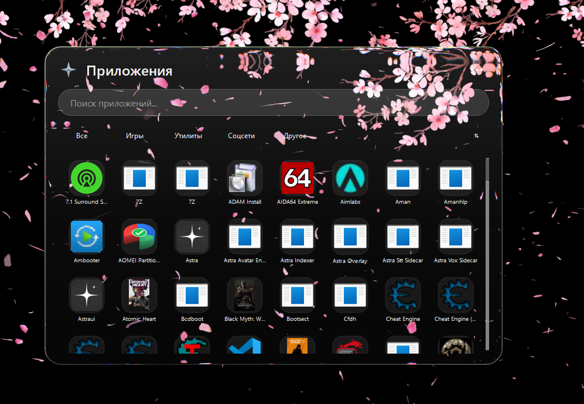
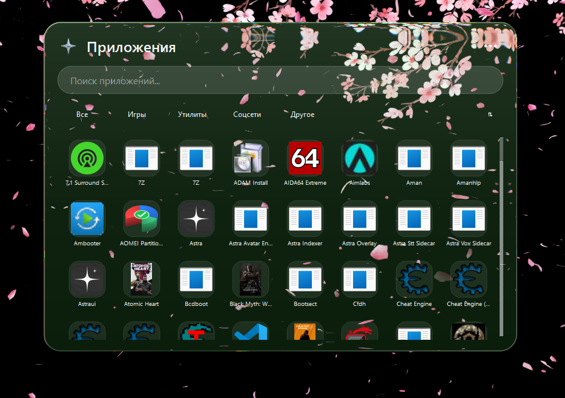
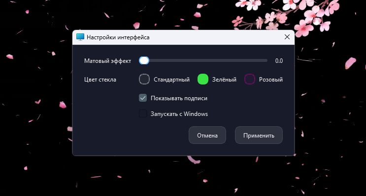

# MOON Launchpad 🌙

A fast, customizable Windows app launcher with application search, mini folders, and a liquid-glass interface.

MOON helps you find and launch installed apps quickly. Organize apps into categories and mini folders, adjust the appearance, and use global shortcuts to open the launcher.

## 📸 Screenshots

### Main interface



### Application search



### Settings



## ✨ Features

- 🔎 Fast application search
- 🚀 Quick application launching
- 📂 Automatic application scanning
- 🗂 Application categories
- ⇅ Multiple sorting modes
- 🎨 Customizable interface
- 🪟 Glassmorphism interface
- 🌫 Background blur and refraction effects
- 🖱 Custom animated UI components
- ⌨ Global hotkey support
- ⚙ Interface settings
- 🚀 Launch with Windows
- 🌓 Theme support

## 🛠 Technologies

- Python 3
- PySide6
- Qt6
- NumPy
- Windows API
- PyWin32
- Custom PyGlass integration

## Install on Windows

Download `MOON-Setup-v1.0.6.exe` from the repository and run it. The installer places MOON in the current user's local application folder and adds Start Menu shortcuts. User settings are created on first launch and are not included in the installer.

## Build on Windows

Use Python 3.13 with the packages listed in `requirements.txt` and PyInstaller 6.21.0. From PowerShell in this folder, run:

```powershell
python -m PyInstaller --clean --noconfirm MOON.spec
Copy-Item dist\MOON.exe Output\MOON-1.0.6.exe -Force
.\build_installer.ps1
```

The installer embeds only the built application and its uninstaller. Keep `.env`, local settings, and credentials out of source control and release files.

## 📁 Project structure

```text
Launchpad/
├── animations/
│   └── animator.py
├── assets/
│   └── icons/
├── models/
│   └── app_model.py
├── pyglass_pyside/
│   ├── backdrop.py
│   ├── blur.py
│   ├── effect.py
│   ├── glass.py
│   ├── pane.py
│   └── refract.py
├── styles/
│   └── style.qss
├── ui/
│   ├── app_card.py
│   ├── dock.py
│   ├── launchpad.py
│   ├── popover_menu.py
│   ├── search.py
│   └── settings_dialog.py
├── utils/
│   ├── app_scanner.py
│   ├── backdrop.py
│   ├── global_hotkey.py
│   ├── icon_cache.py
│   ├── settings_store.py
│   ├── startup.py
│   └── theme.py
├── widgets/
│   ├── animated_label.py
│   ├── hover_button.py
│   ├── liquid_glass.py
│   └── ...
└── main.py
